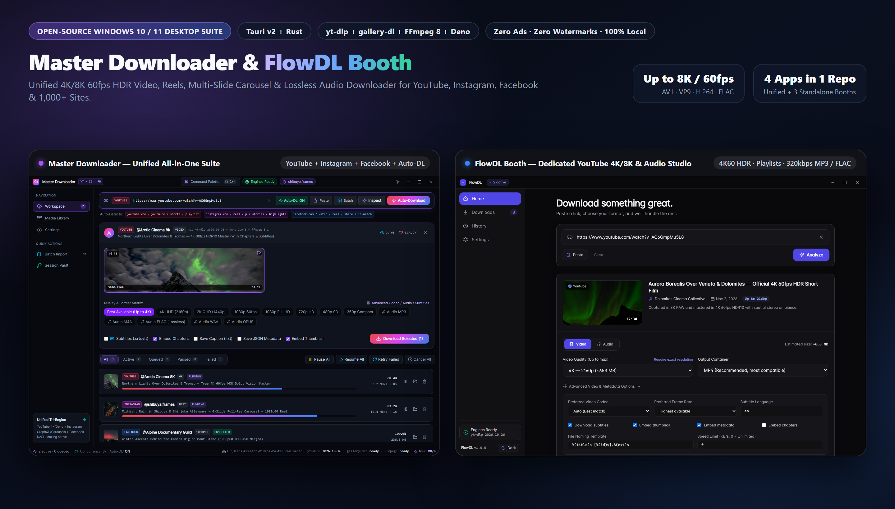
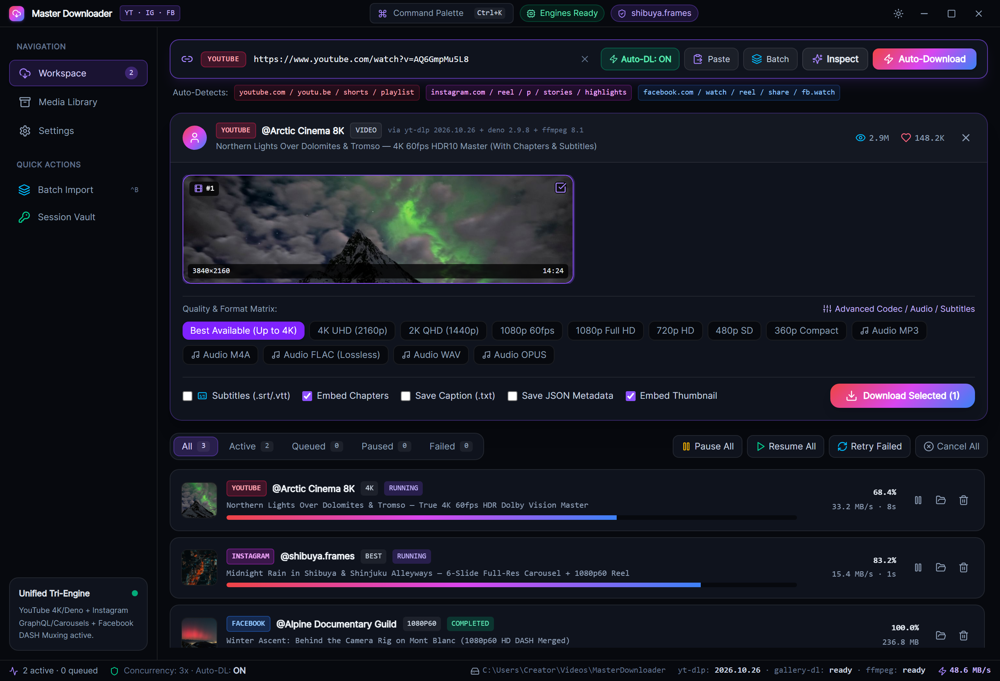
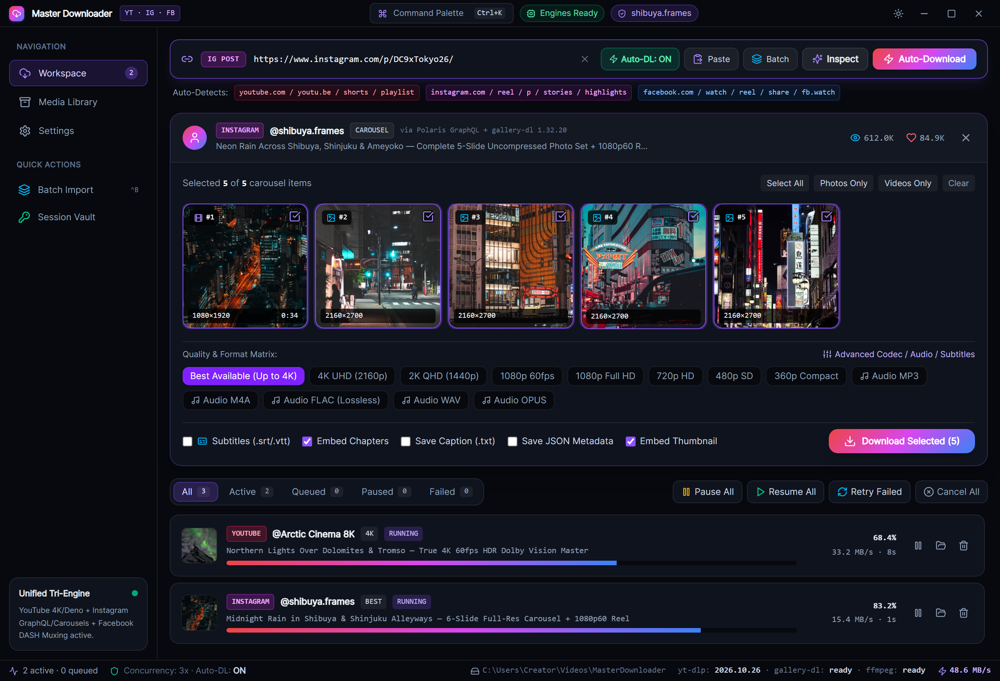
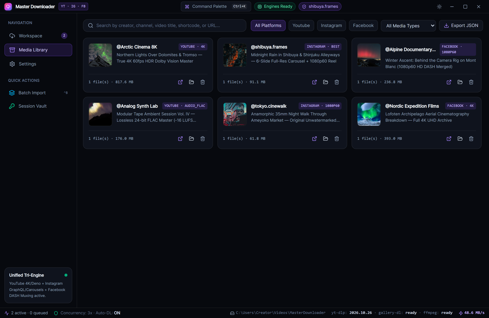
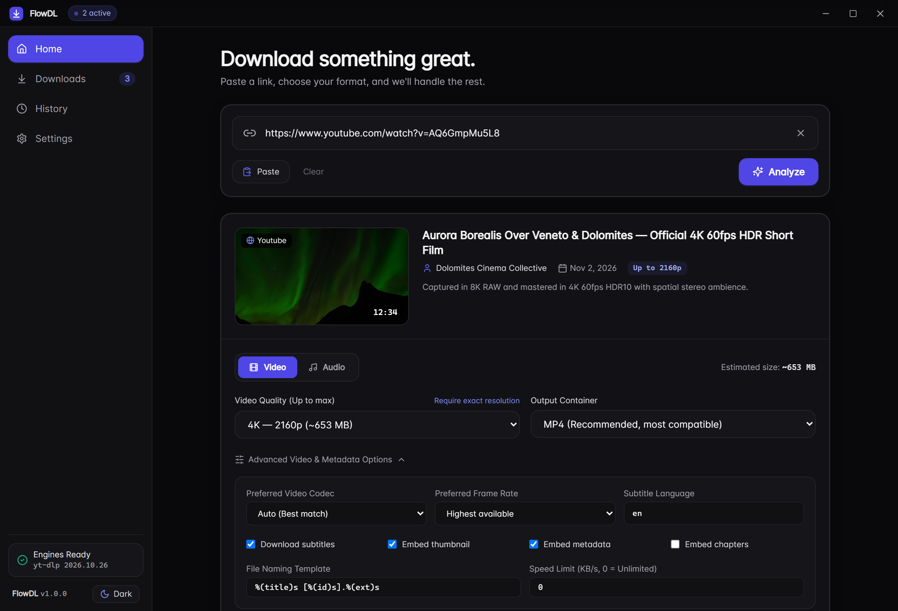
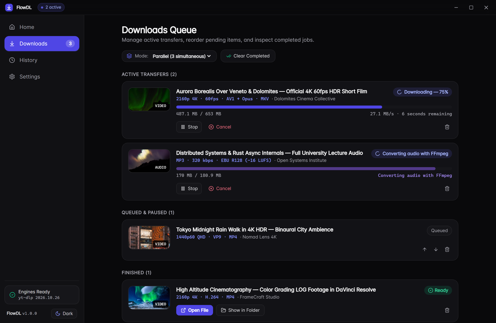

<div align="center">

# Master Downloader & FlowDL — Free Open-Source 4K/8K Video, Reels & Audio Downloader for Windows 10/11

**Unified Desktop GUI for `yt-dlp`, `gallery-dl`, `FFmpeg` & `Deno` — Download YouTube 4K/8K 60fps HDR Videos, Playlists, Lossless FLAC/MP3 Audio, Instagram Reels & Multi-Slide Carousels, and Facebook HD Videos with Zero Ads, Zero Watermarks, and 100% Local Privacy.**

<p>
  <a href="https://github.com/piyushmaurya6/master-downloader/releases/latest">
    
  </a>
  <a href="https://github.com/piyushmaurya6/master-downloader/actions/workflows/build-and-release.yml">
    
  </a>
  <a href="./LICENSE">
    
  </a>
  
</p>

<p>
  <a href="https://github.com/piyushmaurya6/master-downloader/releases/latest">
    
  </a>
  &nbsp;
  <a href="https://github.com/piyushmaurya6/master-downloader/releases/latest">
    
  </a>
</p>

<br />



</div>

---

## What Is Master Downloader & FlowDL?

Online video downloaders are flooded with pop-up ads, 720p paywalls, watermarks, malware traps, and cloud size limits — while command-line power tools like `yt-dlp`, `gallery-dl`, and `FFmpeg` require terminal flags, Python environments, and manual `PATH` setup.

**Master Downloader Suite** solves both problems by packaging `yt-dlp`, `gallery-dl`, `FFmpeg 8`, `ffprobe`, and `Deno` inside ultra-fast, lightweight **Tauri v2 + Rust + React 19** native Windows desktop apps (**under 7 MB app core**, zero Electron bloat, zero terminal windows):

### 1. Master Downloader *(Flagship All-in-One Suite — Recommended)*
One unified Windows desktop app that **automatically detects, inspects, and downloads** links across **YouTube**, **Instagram**, **Facebook**, and **1,000+ `yt-dlp` / `gallery-dl` supported websites**:
- **Zero-Click Clipboard Auto-Download (`Auto-DL: ON`)**: Copy any YouTube, Instagram, or Facebook URL anywhere in Windows and Master Downloader classifies the platform, strips unwanted `&list=RD...` Infinite Mixes, resolves `fb.watch` share redirects, and starts downloading automatically in your preferred quality.
- **Granular Stream & Carousel Inspector (`Inspect`)**: Preview exact resolutions (`8K`, `4K 2160p60 HDR`, `1440p60`, `1080p60`), codecs (`AV1`, `VP9`, `H.264`), subtitle languages, chapter markers, and **individual slides inside Instagram multi-photo/video carousels** before downloading.
- **Built-In Encrypted Session Vault**: Optional isolated WebView2 login & `cookies.txt` / browser cookie delegation stored locally with **AES-256-GCM + Windows Credential Manager** for private reels, stories, highlights, and age-gated videos.

### 2. FlowDL Booth *(Dedicated YouTube 4K/8K & Lossless Audio Studio)*
Included in the same repository and release bundle (`standalone-apps/flowdl/`) for users who want a **pure, distraction-free YouTube video, playlist, and music/podcast workstation**:
- **True 4K/8K 60fps HDR Video Merging**: Downloads separate ultra-high-bitrate YouTube DASH video (`AV1` / `VP9` / `H.264`) and audio streams and muxes them losslessly into `MP4`, `MKV`, or `WebM` via bundled `FFmpeg`.
- **Studio-Grade Audio Extractor**: One-click `320 kbps MP3`, `M4A`, `Opus`, `WAV`, or **lossless `FLAC`** extraction with embedded album art, ID3 metadata, chapter splitting, and **EBU R128 (`-16 LUFS`) broadcast loudness normalization**.
- **Dual Self-Updating Architecture**: Updates `yt-dlp` and `FFmpeg` independently in the background with cryptographic SHA-256 verification and automatic `.bak` rollback if YouTube changes its player signatures.

*(Also included as standalone booths: **InstaFlow** for Instagram Reels/Carousels/Stories and **FlowFB** for Facebook Watch/Reels/Videos.)*

---

## Where Is It Useful? (Real-World Use Cases)

- **Video Editors, Filmmakers & Motion Designers (`Premiere Pro` / `DaVinci Resolve` / `After Effects`)**
  Download clean, unwatermarked **4K 60fps B-roll**, reference commercials, green-screen assets, Instagram Reels, and sound effects directly in edit-ready `H.264 MP4` (for instant NLE timeline scrubbing) or archival `AV1`/`VP9 MKV`.
- **Students, Educators, Developers & Researchers**
  Save university lectures, coding bootcamps, conference talks, and science documentaries alongside **multilingual `.srt`/`.vtt` subtitles and embedded chapter markers** for distraction-free offline study on flights, trains, or low-connectivity campuses.
- **Travelers, Commuters & Audiophiles**
  Batch-convert long-form podcasts, DJ mixes, audiobooks, and YouTube Music playlists into volume-matched (`-16 LUFS`) **`320 kbps MP3`**, **`M4A`**, or **lossless `FLAC`** files for flights, road trips, and dead-zone travel.
- **Social Media Managers, Creators & Agencies**
  Back up your own or client **Instagram multi-slide carousels (`?img_index=N`)**, Reels, Stories, Highlights, and **Facebook Watch** campaigns in original uncompressed resolution with sidecar `.txt` captions and `.json` metadata intact.
- **Journalists, Fact-Checkers & Digital Archivists**
  Preserve public social media footage, live-stream VODs, and eyewitness clips locally on disk with original upload metadata before posts are deleted, geo-restricted, or taken down.
- **Everyday Windows 10 & Windows 11 Users**
  A safe, open-source, **100% ad-free desktop alternative** to shady browser downloader websites — no pop-ups, no browser extensions spying on tabs, no account sign-up, and no artificial file-size caps.

---

## Visual Tour — Master Downloader & FlowDL Booth

### Master Downloader — Unified Multi-Platform Workspace & 4K60 HDR Stream Inspector
> Auto-detects **YouTube**, **Instagram**, and **Facebook** links in one unified queue. Inspect 4K 60fps HDR streams, subtitles, chapters, and lossless audio formats while parallel transfers run at full line speed (`48.6 MB/s`).



---

### Master Downloader — Instagram Multi-Slide Carousel & Unwatermarked Reels Picker
> Inspect multi-slide Instagram Carousels (`xdt_shortcode_media` GraphQL Polaris + `gallery-dl` cascade), filter by *Photos Only* or *Videos Only*, and download exact selected slides in original `2160×2700` JPEG and `1080p60` MP4 quality.



---

### Master Downloader — Searchable Offline Media Library & Archive
> Filter your local archive by platform (`YouTube`, `Instagram`, `Facebook`) or media type (`Video`, `Reels / Shorts`, `Audio FLAC/MP3`, `Photos`), search by creator or title, preview instantly, or reveal files directly in Windows Explorer.



---

### FlowDL Booth — Dedicated YouTube 4K/8K Video & Lossless Audio Studio
> Purpose-built YouTube & Audio booth showing exact available resolutions (`4K — 2160p`, `1440p QHD`, `1080p Full HD`), estimated file sizes, preferred codec (`AV1`, `VP9`, `H.264`), frame rate, subtitle language, and custom naming templates.



---

### FlowDL Booth — Parallel YouTube Playlist, 4K Muxing & `320 kbps` MP3 Queue
> Run sequential or parallel downloads (`1`–`4` simultaneous transfers) with live byte progress, ETA, automatic FFmpeg stream merging, and EBU R128 (`-16 LUFS`) audio conversion.



---

## Download Ready-to-Run Windows Installers (`64-bit`)

Grab the self-contained installer from the **[Latest GitHub Release](https://github.com/piyushmaurya6/master-downloader/releases/latest)** — **no Python, FFmpeg, or command-line setup required**:

| App / Booth | Best For | Self-Contained Windows Installer | Portable Binary |
| :--- | :--- | :--- | :--- |
| **Master Downloader** *(Recommended)* | **All-in-One**: YouTube 4K/8K + Instagram Reels/Carousels/Stories + Facebook Watch/Videos + 1,000+ Sites | `Master_Downloader_x64-setup.exe` | `MasterDownloader.exe` |
| **FlowDL Booth** | **Dedicated YouTube Studio**: 4K/8K 60fps Video, Shorts, Playlists, Subtitles & `FLAC`/`320kbps MP3` Audio | `FlowDL_1.0.0_x64-setup.exe` | `FlowDL.exe` |
| **InstaFlow Booth** | Dedicated Instagram Reels, Multi-Slide Carousels, Stories & Highlights | `InstaFlow_1.0.0_x64-setup.exe` | `InstaFlow.exe` |
| **FlowFB Booth** | Dedicated Facebook Watch, `fb.watch`, Reels, Shared Videos & Photo Albums | `FlowFB_1.0.0_x64-setup.exe` | `FlowFB.exe` |

> **Zero-Admin Per-User Install**: Every `*_x64-setup.exe` NSIS installer bundles `yt-dlp.exe`, `gallery-dl.exe`, `ffmpeg.exe`, `ffprobe.exe`, `deno.exe`, and silent Microsoft Edge WebView2 bootstrapper support. Installs cleanly on Windows 10 & Windows 11 with or without Administrator privileges.

---

## Why Choose Master Downloader & FlowDL?

| Capability | Online Web Downloaders | Raw `yt-dlp` / `gallery-dl` CLI | **Master Downloader + FlowDL** |
| :--- | :---: | :---: | :---: |
| **4K / 8K 60fps HDR with Audio Merged** | Often paywalled or capped at 720p | Requires manual `FFmpeg` flags | **Automatic 1-click DASH muxing** |
| **Ads, Pop-ups & Watermarks** | Heavy adware / redirects | None | **Zero ads, zero watermarks, zero telemetry** |
| **Instagram Multi-Slide Carousels & Reels** | Breaks frequently / low-res | Terminal commands & cookie flags | **Visual slide picker + GraphQL/gallery-dl cascade** |
| **Facebook `fb.watch` & Share Links** | Fails on share redirects | Manual URL unwrapping | **Automatic pre-flight redirect resolver** |
| **Lossless Audio (`FLAC` / `WAV` / `320k MP3`) + `-16 LUFS`** | Low-bitrate re-encodes | Complex FFmpeg filtergraphs | **1-toggle EBU R128 loudness normalization** |
| **RAM & Disk Footprint** | Browser tab bloat | Lightweight | **Native Tauri v2 + Rust (`< 7 MB` core, NTFS hardlinks)** |

---

## Commercial-Grade Under-the-Hood Engineering

- **Win32 Single-Instance Mutex**: Launching a second copy automatically restores and focuses the running window instead of opening duplicate processes over SQLite.
- **SQLite `WAL` + Power-Cut Self-Healing**: Runs with `journal_mode = WAL` and `busy_timeout = 8000ms`. If sudden power loss corrupts the database, startup backs up the damaged file (`.corrupt.<timestamp>.db`) and recovers cleanly.
- **Zero-Copy NTFS Hardlink Sidecar Provisioning (`< 2ms` Cold Start)**: Seeds bundled media engines into `%LOCALAPPDATA%` via NTFS hardlinks (with cross-volume copy fallback), saving over `300 MB` of duplicate disk space.
- **Per-Job Subprocess Tree Control & Byte-Offset Resume**: Tracks child PIDs per `job_id` so pausing or cancelling immediately halts that job's process tree (`taskkill /F /T`) and resumes `.part` files from their exact byte offset (`--continue`).
- **AES-256-GCM Encrypted Cookie Vault**: Protects optional platform sessions at rest using **Windows Credential Manager** + zeroized-on-drop `EphemeralCookieGuard` temp files and automatic token redaction in diagnostic logs.

---

## Build From Source (Windows 10 / 11 x64)

```powershell
# 1. Clone the repository
git clone https://github.com/piyushmaurya6/master-downloader.git
cd master-downloader

# 2. Provision verified sidecar engines (yt-dlp, gallery-dl, Deno, FFmpeg 8)
pwsh -NoProfile -File .\scripts\setup-sidecars.ps1

# 3. Install frontend dependencies, typecheck, run tests & build UI
cd master-downloader
npm install
npm run typecheck
npm run test
npm run build

# 4. Run Rust backend unit tests & build the NSIS installer
cd src-tauri
cargo test --lib -- --skip test_live_multi_platform_inspect_and_download
cd ..
npx tauri build --bundles nsis
```

To build the standalone **FlowDL Booth** (`standalone-apps/flowdl`), **InstaFlow** (`standalone-apps/instaflow`), or **FlowFB** (`standalone-apps/flowfb`), see **[`docs/BUILD_FROM_SOURCE.md`](./docs/BUILD_FROM_SOURCE.md)**.

---

## Frequently Asked Questions (FAQ)

<details>
<summary><strong>Should I install Master Downloader or FlowDL?</strong></summary>
<br />
Install <strong>Master Downloader</strong> if you download from multiple platforms (YouTube, Instagram Reels/Carousels/Stories, Facebook Watch/Reels, Twitter/X, Reddit, Vimeo, SoundCloud, and 1,000+ <code>yt-dlp</code>/<code>gallery-dl</code> sites) or want zero-click clipboard <code>Auto-DL</code>. Choose the standalone <strong>FlowDL Booth</strong> if you want a minimalist app dedicated exclusively to YouTube 4K/8K video, playlists, and MP3/FLAC audio extraction. Both can even be installed side by side.
</details>

<details>
<summary><strong>Why do some websites download 4K YouTube videos without sound, while Master Downloader &amp; FlowDL include full audio?</strong></summary>
<br />
YouTube serves resolutions above 720p/1080p (such as <code>1440p60</code>, <code>4K 2160p60</code>, and <code>8K</code>) as separate adaptive DASH video and audio streams. Master Downloader and FlowDL bundle a private copy of <strong>FFmpeg + Deno</strong> to download the highest-bitrate video and audio streams simultaneously and merge them losslessly into a single playable <code>.mp4</code> or <code>.mkv</code> file automatically.
</details>

<details>
<summary><strong>Do I need to log in to download public YouTube, Instagram, or Facebook videos?</strong></summary>
<br />
<strong>No.</strong> Public YouTube videos/playlists, public Instagram Reels &amp; multi-slide carousels, and public Facebook Watch/Reel links work out of the box in zero-login <strong>Public Mode</strong>. The encrypted <strong>Session Vault</strong> is strictly optional and only needed for private accounts you follow, Instagram Stories/Highlights, or age-restricted streams.
</details>

<details>
<summary><strong>Is it safe and completely offline/local?</strong></summary>
<br />
Yes. Master Downloader and FlowDL are 100% open-source (MIT / GPLv3), run locally on your Windows PC with zero tracking, zero analytics, and zero cloud proxy servers, and verify all release installers via <code>SHA256SUMS.txt</code>.
</details>

---

## Documentation & Architecture Guides

- **[End-User Manual (`docs/USER_MANUAL.md`)](./docs/USER_MANUAL.md)** — Auto-DL, Inspect mode, Session Vault, Audio Normalization & Troubleshooting.
- **[Architecture & Convergence Spec (`docs/ARCHITECTURE_AND_CONVERGENCE.md`)](./docs/ARCHITECTURE_AND_CONVERGENCE.md)** — Multi-engine Rust state machine, GraphQL Polaris extractor & URL router.
- **[Build & Code-Signing Guide (`docs/BUILD_FROM_SOURCE.md`)](./docs/BUILD_FROM_SOURCE.md)** — Compiling, testing & Authenticode-signing all 4 desktop apps.
- **[Security Model (`SECURITY.md`)](./SECURITY.md)** & **[Third-Party Notices (`THIRD_PARTY_NOTICES.md`)](./THIRD_PARTY_NOTICES.md)**.

---

## License & Disclaimer

Original source code is licensed under the **[MIT License](./LICENSE)**; self-contained binary installers bundling GPLv3 `FFmpeg` are distributed under **`GPL-3.0-or-later`** (see [`THIRD_PARTY_NOTICES.md`](./THIRD_PARTY_NOTICES.md)).

*Master Downloader and FlowDL are independent open-source tools intended solely for downloading content you own, Creative Commons / open-licensed media, or material you have explicit permission to archive offline. Not affiliated with YouTube, Google, Instagram, or Meta.*
