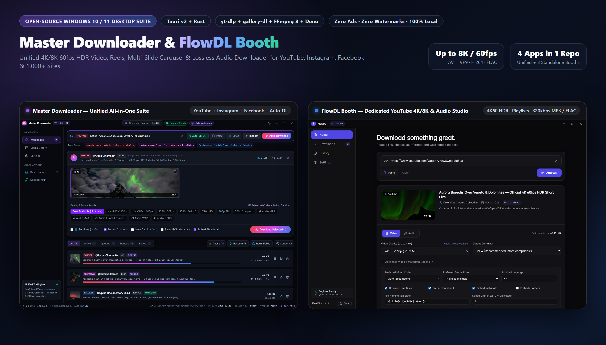
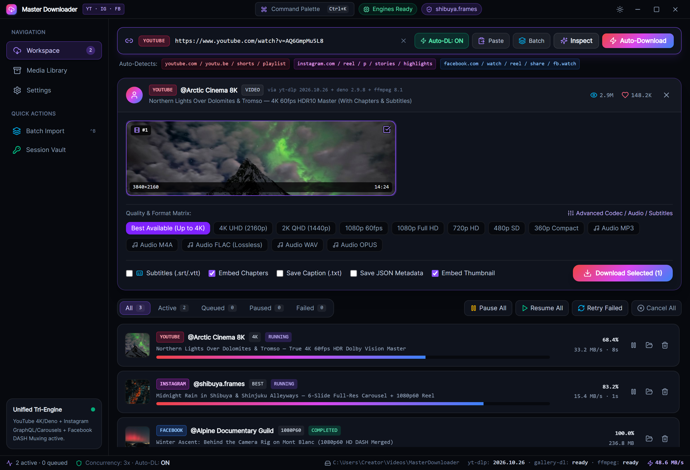
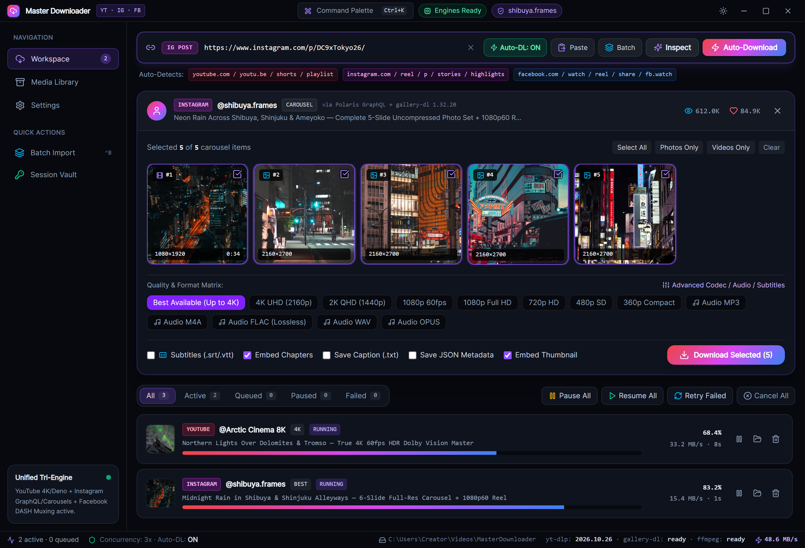
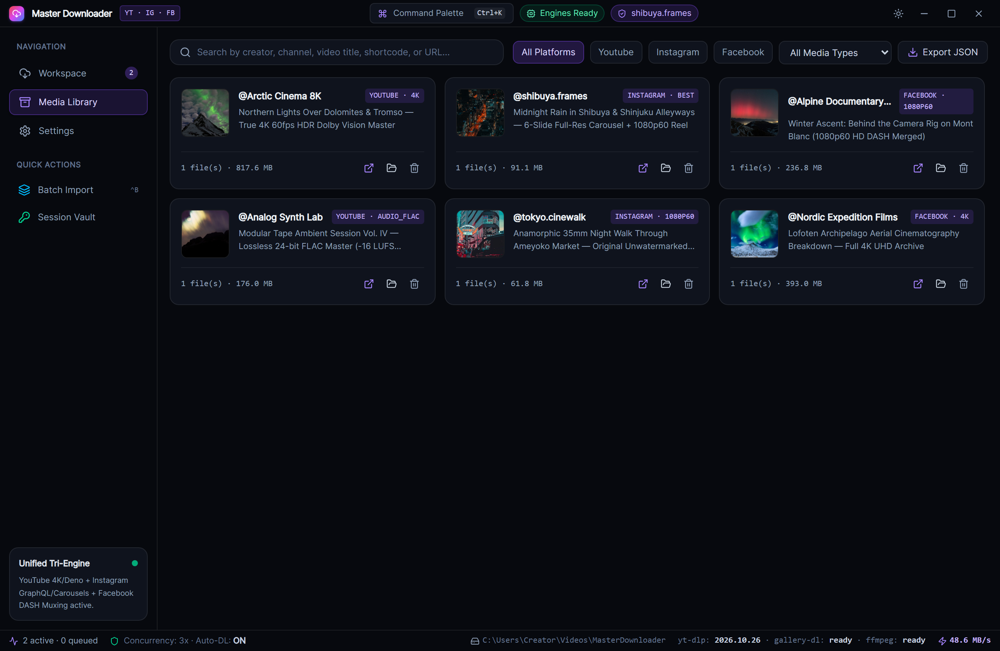
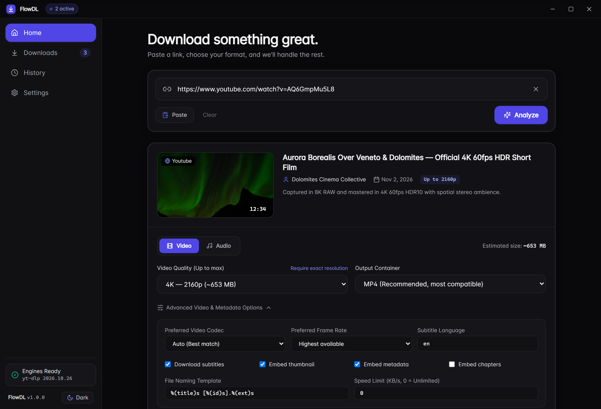
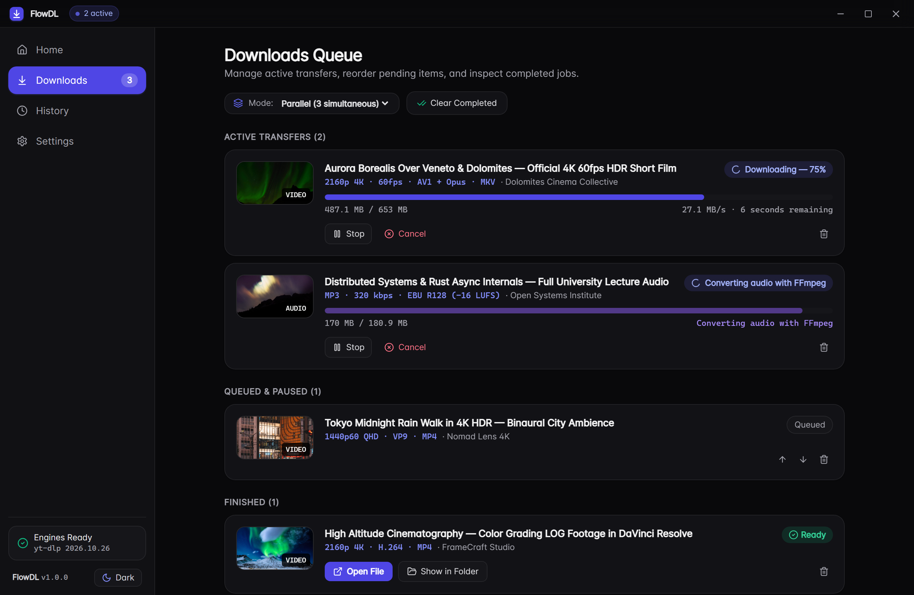

# Master Downloader & FlowDL Suite `v1.1.0` — Free Open-Source 4K/8K Video, Reels & Lossless Audio Downloader for Windows 10/11

**Master Downloader & FlowDL Suite (`v1.1.0`)** is a fast, 100% self-contained, open-source **Windows 10 / 11 (x64)** desktop GUI powered by **`yt-dlp`**, **`gallery-dl`**, **`FFmpeg 8`**, and **`Deno`** (built natively with **Tauri v2 + Rust + React 19** — under `7 MB` core binary, zero ads, zero watermarks, zero cloud middleman).

---

## Which Installer Should I Download?

- **`Master_Downloader_x64-setup.exe`** *(Recommended for Most Users — All-in-One Suite)*
  Unified desktop downloader that **auto-detects and downloads** from **YouTube** (`8K` / `4K 60fps HDR`, Shorts, Playlists, Music), **Instagram** (Reels, Multi-Slide Carousels, Stories & Highlights), **Facebook** (`fb.watch`, Watch, Reels, Shared Videos & Photo Albums), and **1,000+ `yt-dlp` / `gallery-dl` supported sites** — with zero-click clipboard `Auto-DL`, selective carousel slide picker, EBU R128 `-16 LUFS` loudness normalization, and an encrypted AES-256-GCM Session Vault.
- **`FlowDL_1.0.0_x64-setup.exe`** *(Dedicated YouTube 4K/8K & Audio Booth)*
  Lightweight, distraction-free studio built specifically for **YouTube 4K/8K 60fps HDR video muxing** (`MP4` / `MKV` / `WebM` · `AV1` / `VP9` / `H.264`), playlists, subtitles, chapters, and **`320 kbps MP3` / `M4A` / lossless `FLAC` / `WAV` / `Opus`** audio extraction.
- **Additional Standalone Booths *(Optional)*:**
  - `InstaFlow_1.0.0_x64-setup.exe` — Dedicated Instagram Reels, Carousels & Stories desktop app
  - `FlowFB_1.0.0_x64-setup.exe` — Dedicated Facebook Watch, Reels & Videos desktop app
  - Portable executables (`MasterDownloader.exe`, `FlowDL.exe`, `InstaFlow.exe`, `FlowFB.exe`) + `SHA256SUMS.txt`

---

## What It Does & Where It Is Useful

1. **Video Editors, Filmmakers & Content Creators (`Premiere Pro`, `DaVinci Resolve`, `After Effects`)**: Pull clean, unwatermarked `4K 60fps` B-roll, reference edits, Instagram Reels, and sound effects directly into edit-ready `H.264 MP4` or archival `AV1`/`VP9 MKV` with audio automatically merged.
2. **Students, Educators, Developers & Researchers**: Archive university lectures, coding bootcamps, technical talks, and documentaries with `.srt`/`.vtt` subtitles and chapter markers for offline viewing during flights, commutes, or low-bandwidth travel.
3. **Commuters, Travelers & Music/Podcast Listeners**: Convert playlists, long-form interviews, DJ sets, and talks into volume-normalized (`-16 LUFS`) `320 kbps MP3`, `M4A`, or lossless `FLAC` with embedded cover art.
4. **Social Media Managers, Agencies & Creators**: Back up multi-slide Instagram Carousels (`?img_index=N`), Stories, Highlights, and Facebook Watch campaigns in full uncompressed resolution alongside `.txt` captions and `.json` metadata.
5. **Journalists & Digital Archivists**: Preserve public social video evidence locally on disk with SHA-256 verified open-source engines (`yt-dlp` + `gallery-dl` + `FFmpeg`) before posts vanish.
6. **Everyday Windows 10/11 Users**: Replace sketchy pop-up downloader websites and 720p paywalls with a clean, private, ad-free local desktop app that installs without Administrator rights.

---

## Live Screenshots — Master Downloader & FlowDL Booth

### 1. Master Downloader — Unified Multi-Platform Workspace (`YouTube 4K60` + `Instagram` + `Facebook`)

### 2. Master Downloader — Instagram Multi-Slide Carousel & Reels Picker

### 3. Master Downloader — Searchable Offline Media Library

### 4. FlowDL Booth — Dedicated YouTube 4K/8K Video & Lossless Audio Studio

### 5. FlowDL Booth — Parallel YouTube Playlist, 4K Muxing & `320 kbps` MP3 Queue

---

## What's New in `v1.1.0`
- **Resilient Codeberg + Multi-Mirror Engine Bootstrap**: Updated `gallery-dl` auto-provisioning in both CI (`scripts/setup-sidecars.ps1`) and the in-app Rust `BinaryManager` to dynamically resolve official Codeberg releases (`v1.32.20+`) with `gdl-org/builds` fallback, plus redundant `FFmpeg 8` GPL shared mirrors.
- **Verified Automated Windows x64 CI/CD Build**: Full automated NSIS installer + portable executable compilation on GitHub Actions (`windows-latest`), frontend & Rust unit test verification, and MSVC Common Controls v6 manifest hardening.
- **Complete Suite Bundle**: Includes the updated **Master Downloader `v1.1.0`** installer alongside the standalone **FlowDL**, **InstaFlow**, and **FlowFB** booth installers and cryptographic `SHA256SUMS.txt`.
