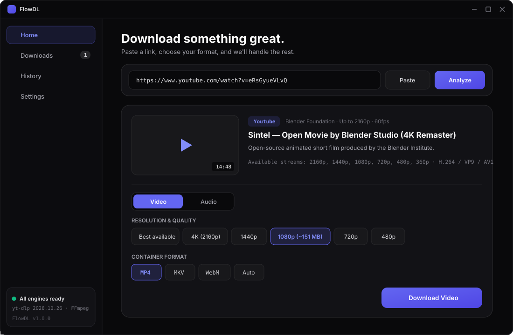

<div align="center">
  
  <h1>FlowDL</h1>
  <p><strong>A modern, self-contained Windows desktop video and audio downloader powered by yt-dlp and FFmpeg.</strong></p>

  <p>
    <a href="https://github.com/piyushmaurya6/flowdl/releases/latest">
      
    </a>
    <a href="https://github.com/piyushmaurya6/flowdl/actions/workflows/ci.yml">
      
    </a>
    <a href="./LICENSE">
      
    </a>
    
  </p>

  <p>
    <a href="https://github.com/piyushmaurya6/flowdl/releases/download/v1.0.0/FlowDL_1.0.0_x64-setup.exe">
      
    </a>
  </p>
</div>

---

## Screenshot

<div align="center">
  
</div>

---

## Overview

`yt-dlp` and `FFmpeg` are the gold standard for downloading and muxing online media, but using them directly requires command-line flags, Python/PATH configuration, and terminal windows.

**FlowDL** wraps a private, self-contained bundle of `yt-dlp`, `FFmpeg`/`ffprobe`, and `Deno` inside a lightweight native **Tauri 2 + Rust** Windows desktop application. Users install a single `.exe` and get a responsive graphical workflow — with zero terminal windows, zero Python setup, and independent background engine updates.

---

## Features

- **100% Self-Contained Windows Installer**:
  - Bundles verified private copies of `yt-dlp.exe`, `ffmpeg.exe`, `ffprobe.exe`, shared FFmpeg libraries, and `deno.exe` (for YouTube `yt-dlp-ejs` JavaScript challenge solving).
  - Never requires installing Python, `yt-dlp`, `FFmpeg`, or PowerShell tools separately.
- **Completely Invisible Backend Execution**:
  - All child processes run asynchronously with `CREATE_NO_WINDOW` (`0x08000000`). No CMD or PowerShell window ever flashes.
  - Native Win32 folder selection (`SHBrowseForFolderW` via `shell32.dll`) and Explorer file reveal (`/select,<path>`).
- **Real-Time URL Metadata Analysis**:
  - Inspects URLs via `yt-dlp --dump-single-json --flat-playlist` to display title, thumbnail, channel, duration, and genuinely available video heights (`2160p 4K` down to `360p`), codecs (`H.264`, `H.265`, `VP9`, `AV1`), frame rates, and subtitles.
  - Detects playlists and lets you choose between downloading the single video or the entire playlist.
- **Video & Audio Format Selection**:
  - **Video Mode**: Quality presets (`Best available`, `4K 2160p`, `1440p`, `1080p`, `720p`, `480p`, `360p`), exact vs. maximum resolution toggle, containers (`MP4`, `MKV`, `WebM`, `Auto`), subtitle download, chapter markers, and metadata embedding.
  - **Audio Mode**: Formats (`MP3`, `M4A`, `Original Best`, `FLAC`, `WAV`, `OPUS`), target bitrates (`320 / 256 / 192 / 128 kbps`), cover art embedding, and optional EBU R128 loudness normalization (`loudnorm`).
- **Dual Independent Update Systems**:
  - **System A (Application Updater)**: Checks GitHub Releases for newer FlowDL versions, displays release notes, and coordinates upgrades with active downloads.
  - **System B (Engine Manager & Self-Repair)**: Independently updates `yt-dlp` and `FFmpeg` in `%LOCALAPPDATA%\FlowDL\bin` with SHA-256 verification and automatic `.bak` rollback if validation fails.
- **Versioned SQLite Queue & History**:
  - Stores download history and active queue state in `%LOCALAPPDATA%\FlowDL\flowdl.db` with transactional SQLite schema migrations.
  - Interrupted downloads are safely restored to `queued` state on restart and resume partial files via `--continue`.

---

## Installation

1. Download **`FlowDL_1.0.0_x64-setup.exe`** from the [**Latest GitHub Release**](https://github.com/piyushmaurya6/flowdl/releases/latest).
2. Run the installer. FlowDL installs per-user into `%LOCALAPPDATA%\FlowDL` (no Administrator elevation required) and creates Start Menu and optional Desktop shortcuts.
3. Launch **FlowDL** from your Start Menu or Desktop.

> **Note on Windows SmartScreen & WebView2**:
> - Windows 11 and updated Windows 10 machines include the Microsoft Edge WebView2 runtime out of the box; if missing, the installer automatically invokes the official Microsoft WebView2 bootstrapper.
> - Community open-source builds that are not signed with a commercial EV Authenticode certificate may show a Windows SmartScreen prompt on first run (*More info → Run anyway*). You can verify the installer's integrity against the `.sha256` file attached to the GitHub Release.

---

## Usage

1. **Paste URL**: Copy any supported video or audio link and click **Paste** (or press `Ctrl+V`) on the **Home** tab, then click **Analyze**.
2. **Select Format**: Choose **Video** (`MP4`, `MKV`, `WebM`, `Auto`) or **Audio** (`MP3`, `M4A`, `FLAC`, `WAV`, `OPUS`).
3. **Select Quality**: Pick from the resolutions genuinely available on the source media (e.g., `4K 2160p`, `1080p`, or `320 kbps` audio).
4. **Download**: Click **Download Video** / **Download Audio** (or press `Ctrl+Enter`). Track live byte progress, speed, ETA, and FFmpeg post-processing stages in the **Downloads** tab.
5. **Find Downloaded Files**: Click **Open File** or **Show in Folder** on any completed download card or in the **History** tab. Default output location is your Windows `Downloads` folder.

---

## Development

To build FlowDL from source on Windows 10/11 (x64):

```powershell
# 1. Clone repository & install frontend dependencies
git clone https://github.com/piyushmaurya6/flowdl.git
cd flowdl
npm install

# 2. Fetch and SHA-256 verify bundled binaries (yt-dlp, FFmpeg, ffprobe, Deno)
powershell -ExecutionPolicy Bypass -File scripts/prepare-bundled-binaries.ps1

# 3. Run frontend & backend verification suites
npm run typecheck
npm run lint
npm run test
cd src-tauri && cargo test && cd ..

# 4. Launch in development mode or build the NSIS installer
npm run tauri dev
npm run tauri build -- --bundles nsis
```

Detailed engineering documentation is available in [`docs/`](./docs/):
- [`docs/architecture.md`](./docs/architecture.md) — 5-layer architecture, `DownloadEngine` trait, and IPC event schemas
- [`docs/development.md`](./docs/development.md) — Toolchain setup and maintenance playbooks
- [`docs/release-process.md`](./docs/release-process.md) — Signing keys and automated GitHub Releases
- [`docs/auto-updates.md`](./docs/auto-updates.md) — Dual application and engine update systems
- [`docs/security-model.md`](./docs/security-model.md) — Threat model, process isolation, and SHA-256 verification
- [`docs/dependency-licenses.md`](./docs/dependency-licenses.md) — License obligations
- [`docs/troubleshooting.md`](./docs/troubleshooting.md) — Error codes and self-repair guide

---

## Technology Stack

| Layer | Technology |
| :--- | :--- |
| **Desktop Shell & Backend** | [Tauri 2](https://v2.tauri.app/) & [Rust](https://www.rust-lang.org/) (`tokio`, `reqwest`, `rusqlite`, `sha2`) |
| **Frontend UI** | [React 18](https://react.dev/), [TypeScript](https://www.typescriptlang.org/), [Vite](https://vite.dev/), [Tailwind CSS](https://tailwindcss.com/), [Framer Motion](https://motion.dev/), [Lucide Icons](https://lucide.dev/) |
| **Bundled Download & Media Engines** | [`yt-dlp`](https://github.com/yt-dlp/yt-dlp), [`FFmpeg` & `ffprobe`](https://github.com/yt-dlp/FFmpeg-Builds), [`Deno`](https://deno.com/) |
| **Local Storage** | SQLite (`%LOCALAPPDATA%\FlowDL\flowdl.db`) with versioned migrations & atomic JSON settings |

---

## Security & Privacy

- **100% Local & Direct**: All network traffic flows directly between your computer and the media provider (plus GitHub Releases for update checks). FlowDL has no cloud accounts, no proxy servers, and zero telemetry.
- **No Shell Injection**: All external binaries are invoked via structured argument arrays with `--` argument termination and `CREATE_NO_WINDOW`.
- **SHA-256 Verified Engine Updates**: Engine updates are verified against official `SHA2-256SUMS` / `checksums.sha256` before activation and automatically roll back on failure.
- To report a security vulnerability privately, please see [`SECURITY.md`](./SECURITY.md).

---

## Contributing

Contributions, bug reports, and feature requests are welcome! Please read [`CONTRIBUTING.md`](./CONTRIBUTING.md) and our [`CODE_OF_CONDUCT.md`](./CODE_OF_CONDUCT.md) before submitting a pull request.

---

## Credits & Acknowledgments

FlowDL stands on the shoulders of the open-source multimedia community:
- [**yt-dlp**](https://github.com/yt-dlp/yt-dlp) (`The Unlicense`)
- [**FFmpeg**](https://ffmpeg.org/) & [**yt-dlp/FFmpeg-Builds**](https://github.com/yt-dlp/FFmpeg-Builds) (`GNU GPLv3`)
- [**Deno**](https://github.com/denoland/deno) (`MIT License`)
- [**Tauri**](https://github.com/tauri-apps/tauri) (`MIT / Apache-2.0`)

---

## License & Disclaimer

Because the self-contained Windows installer bundles GPLv3 `FFmpeg` binaries, the combined FlowDL distribution is licensed under the **GNU General Public License v3.0 or later (`GPL-3.0-or-later`)**, while FlowDL's original source code is dual-licensed under the **MIT License**. See [`LICENSE`](./LICENSE) and [`THIRD_PARTY_NOTICES.md`](./THIRD_PARTY_NOTICES.md) for full details.

**Disclaimer**: FlowDL is an independent open-source project and is not affiliated with, endorsed by, or sponsored by YouTube, Google, or the `yt-dlp` project. Users are solely responsible for complying with applicable copyright laws and terms of service, and should download content only when they have permission to do so.
