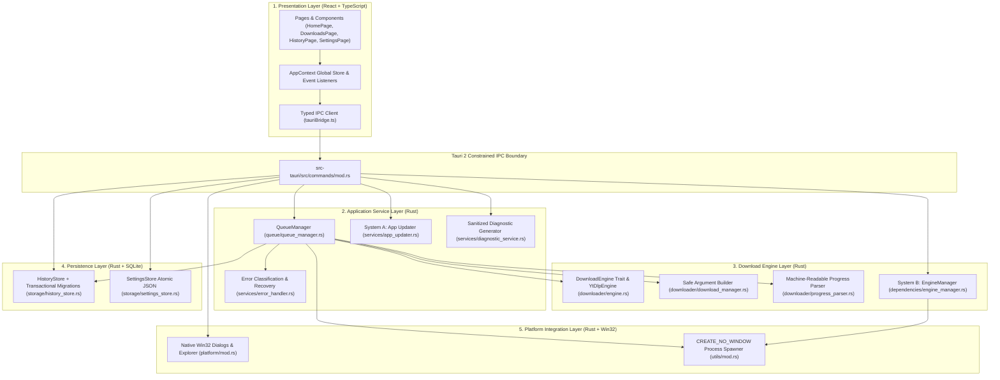
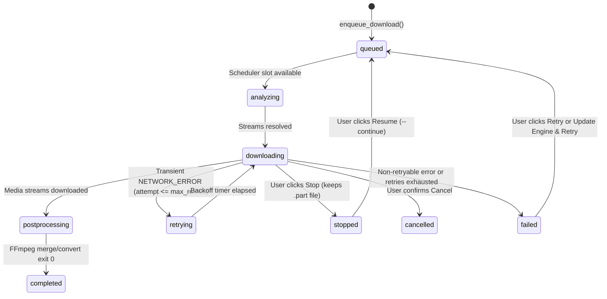

# FlowDL Architecture Guide

FlowDL is architected as a modular, 5-layer Windows desktop application using **Tauri 2**, **Rust**, **React 18**, and **TypeScript**.

---

## 1. Layered Architecture Overview

---

## 2. Layer Responsibilities

1. **Presentation Layer (`src/`)**:
   - Owns UI components, keyboard shortcuts, theme switching, and progress visualization.
   - Never constructs or executes raw shell commands.
2. **Application Service Layer (`src-tauri/src/queue/`, `src-tauri/src/services/`)**:
   - Owns URL validation, concurrency scheduling (`max_concurrent_downloads`), cancellation via `tokio::sync::watch`, automatic transient retries, error classification, and System A application updates.
3. **Download Engine Layer (`src-tauri/src/downloader/`, `src-tauri/src/dependencies/`)**:
   - Owns the `DownloadEngine` trait (`YtDlpEngine`), argument construction (`--progress-template`, `--print after_move:FLOWDL_FILEPATH|%(filepath)s`, `--js-runtimes deno:<path>`), line-by-line progress parsing, and `EngineManager` (System B).
4. **Persistence Layer (`src-tauri/src/storage/`, `src-tauri/migrations/`)**:
   - Owns `%LOCALAPPDATA%\FlowDL\flowdl.db` (SQLite with versioned transactional migrations in `schema_migrations`) and `%LOCALAPPDATA%\FlowDL\settings.json`.
5. **Platform Integration Layer (`src-tauri/src/platform/`, `src-tauri/src/utils/`)**:
   - Owns `CREATE_NO_WINDOW` (`0x08000000`) process spawning, native Win32 `SHBrowseForFolderW` folder selection, Windows Explorer reveal (`/select,<path>`), and Windows filename/path sanitization.

---

## 3. Typed Event Contracts

FlowDL emits structured events from the Rust backend to the React frontend:

| Event Name | Payload Type | Trigger |
| :--- | :--- | :--- |
| `download:queued` | `DownloadEventPayload` | Item validated and added to queue |
| `download:started` | `DownloadEventPayload` | Child process spawned (`downloading` / `retrying`) |
| `download:progress` | `DownloadEventPayload` | Numeric progress (`downloadedBytes`, `totalBytes`, `speedBytesPerSec`, `etaSeconds`) |
| `download:postprocessing` | `DownloadEventPayload` | FFmpeg stream merging, audio conversion, or metadata embedding |
| `download:completed` | `DownloadEventPayload` | Post-processing finished and final output file verified on disk |
| `download:failed` | `DownloadEventPayload` | Error classified with canonical `errorCode` and `recoveryAction` |
| `download:cancelled` | `DownloadEventPayload` | User stopped or cancelled the download |
| `engine:update-available` | `EngineUpdateInfo` | Newer `yt-dlp` release detected on official GitHub releases |
| `app:update-available` | `AppUpdateInfo` | Newer FlowDL application release detected |
| `queue-updated` | `Vec<DownloadItem>` | Full queue snapshot synchronized after state transitions |

---

## 4. Download State Machine

