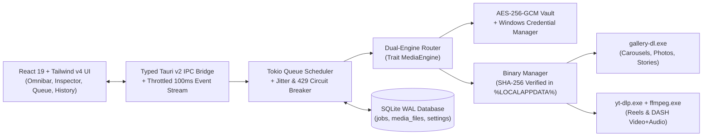

# InstaFlow

<div align="center">

-0078D6?style=for-the-badge&logo=windows)


**Commercial-grade, self-contained Windows desktop application for archiving permitted Instagram media (Reels, Carousels, Photos, Stories, and Highlights) in highest available quality.**

</div>

---

## ✨ Highlights & Key Features

- **Zero-Dependency Self-Contained Engine Manager:** Automatically downloads, SHA-256 verifies, and updates standalone Windows x64 binaries (`yt-dlp.exe`, `gallery-dl.exe`, `ffmpeg.exe`, `ffprobe.exe`) inside `%LOCALAPPDATA%\InstaFlow\bin\`. Users never touch Python, PowerShell, or PATH variables.
- **Dual-Engine Smart Router (`gallery-dl` + `yt-dlp` + `FFmpeg`):**
  - Routes **Reels & Videos** to `yt-dlp` + `FFmpeg` for highest-bitrate DASH video (`mp4`) + audio (`m4a`) lossless stream merging.
  - Routes **Photos, Multi-Slide Carousels, Stories, and Highlights** to `gallery-dl` while delegating video slides inside mixed carousels to `yt-dlp` so audio is never stripped.
- **Interactive Media Inspector & Carousel Slide Picker:** Inspect any link before downloading, preview CORS-proxied thumbnails (`1/10`, `2/10`), filter by `Select All`, `Photos Only`, or `Videos Only`, and pick quality presets (`Highest Available`, `1080p MP4`, `720p MP4`, `Audio Only M4A`).
- **AES-256-GCM Encrypted Session Vault + Windows Credential Manager:**
  - **Never** asks you to type your password into a custom form.
  - Connect via an isolated, sandboxed **Tauri WebView2 Login Window** (2FA compatible), delegate to a local browser profile (`Edge`, `Chrome`, `Firefox`, `Brave`), or import a Netscape `cookies.txt` file.
  - Session cookies are encrypted on disk (`vault.bin`) with `AES-256-GCM`, and the 256-bit master key is stored in **Windows Credential Manager** (`keyring`). Decrypted cookies are passed via ephemeral files that are zeroized and deleted immediately on process exit.
- **Anti-Ban Rate-Limit Hygiene & Global Circuit Breaker:**
  - Enforces randomized human jitter (`2.0s – 5.0s`) between consecutive metadata requests.
  - Automatically trips the **Global Circuit Breaker** on HTTP `429`, `checkpoint_required`, or `login_required`, pausing queued jobs to protect your account.
- **Linear / Raycast Keyboard-First UI:**
  - `Ctrl+K` Global Command Palette
  - `Ctrl+V` anywhere in the window to paste & inspect a link
  - `Ctrl+Shift+B` Batch URL Downloader with real-time deduplication and `.txt`/`.csv` import
  - 60fps virtualized SQLite Download History & Media Library with disk file verification

---

## 🏗️ Architecture Overview



---

## 🚀 Development & Build Setup

```powershell
# 1. Install dependencies
pnpm install

# 2. Run Frontend Typecheck & Unit Tests
pnpm typecheck
pnpm test

# 3. Run Rust Backend Unit Tests
cd src-tauri
cargo test

# 4. Start InstaFlow in Development Mode
cd ..
pnpm tauri dev

# 5. Build Native Windows NSIS Installer (.exe)
pnpm tauri build --bundles nsis
```

---

## 🔒 Security & Privacy Guarantees

- **Least-Privilege Tauri v2 Capabilities:** Scoped window and event permissions in `src-tauri/capabilities/default.json`.
- **Zero Shell Interpolation:** Child processes are spawned directly via `tokio::process::Command` with `.creation_flags(0x08000000)` (`CREATE_NO_WINDOW`) and `--` argument termination.
- **Orphan Process Prevention:** Active child PIDs are tracked in `ProcessRegistry` and terminated cleanly on job cancellation or `RunEvent::ExitRequested`.
- **Automatic PII & Cookie Scrubbing:** All diagnostic logs and exported issue bundles scrub `sessionid`, `csrftoken`, `ds_user_id`, and Windows user profile paths.

---

## ⚖️ Legal Disclaimer

InstaFlow is an independent open-source personal archiving utility designed solely for downloading public media or content that the authenticated user is explicitly authorized to access. InstaFlow does not bypass private account restrictions or DRM, and is not affiliated with, endorsed by, or sponsored by Meta Platforms, Inc. or Instagram. Users are solely responsible for complying with applicable copyright laws and terms of service.
